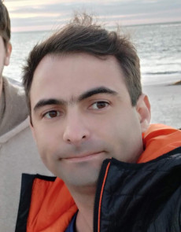
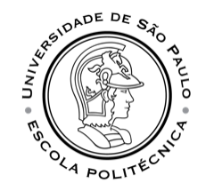

<!--
  Layout notes (styles in docs/stylesheets/extra.css):
  - cv-hero     : photo, name, headline, pitch, facts, call-to-action buttons, profiles
  - cv-stats    : four key figures (keep them factual and up to date)
  - cv-entry    : one role / degree -> head (h3 + period), org line, summary, tags, optional
                  
 for long lists (courses, funding, earlier roles)
  - cv-rows     : compact one-line records (grants, service, press, languages)
  - data-goatcounter-click on links names the conversion events counted by the analytics
-->

{ .cv-hero__photo width="230" height="295" }

# Humberto Sandmann

Computer Scientist · Professor at Insper · Software Architect &amp; AI Engineer

I design, build and teach intelligent large-scale software, combining a D.Sc. in neural computing with more than 25 years of engineering in banking, fintech and artificial intelligence.

:material-map-marker-outline: São Paulo, Brazil
:material-passport: Brazilian &amp; German citizen
:material-airplane-takeoff: Open to relocation

[:material-download: Résumé (PDF)](./assets/doc/sandmann-resume.pdf){ .cv-btn .cv-btn--primary download="sandmann-resume.pdf" data-goatcounter-click="download-resume" }
[:material-school-outline: Academic CV](./assets/doc/sandmann-academic.pdf){ .cv-btn download="sandmann-academic.pdf" data-goatcounter-click="download-academic-cv" }
[:material-email-outline: Get in touch](mailto:hsandmann@ieee.org){ .cv-btn data-goatcounter-click="email-hero" }

[:material-linkedin:](https://www.linkedin.com/in/hsandmann/){ title="LinkedIn" aria-label="LinkedIn" target="_blank" rel="me noopener" data-goatcounter-click="out-linkedin" }
[:material-github:](https://github.com/hsandmann){ title="GitHub" aria-label="GitHub" target="_blank" rel="me noopener" data-goatcounter-click="out-github" }
[:simple-googlescholar:](https://scholar.google.com/citations?user=EG3wtRIAAAAJ){ title="Google Scholar" aria-label="Google Scholar" target="_blank" rel="me noopener" data-goatcounter-click="out-scholar" }
[:simple-orcid:](https://orcid.org/0000-0001-7758-695X){ title="ORCID 0000-0001-7758-695X" aria-label="ORCID" target="_blank" rel="me noopener" data-goatcounter-click="out-orcid" }
<a href="https://graphole.com" title="Graphole" aria-label="Graphole" target="_blank" rel="noopener" data-goatcounter-click="out-graphole"></a>

    
<strong>25+</strong>years building software for banking, fintech &amp; retail

    
<strong>15+</strong>years teaching computer science at university level

    
<strong>D.Sc.</strong>University of São Paulo · Max Planck Institute

    
<strong>20+</strong>TV, radio &amp; press features as a technology expert

## About

Computer scientist and professor with a D.Sc. from the University of São Paulo and a research stay at the Max Planck Institute for Dynamics and Self-Organization. My research bridges bio-inspired neural computing, nonlinear dynamics and pattern recognition, investigating how biological neuronal mechanisms can inform computational intelligence.

Alongside more than a decade of university teaching, I have worked as a senior software architect and machine learning engineer on high-stakes systems — core banking, cryptography (PKI/HSM), high-performance computing, computer vision and cloud-native microservices — bringing research depth and applied engineering into the classroom.

    

        <h3>AI &amp; Machine Learning</h3>
        <ul class="cv-tags"><li>Deep Learning</li><li>Neural Networks</li><li>Computer Vision</li><li>NLP</li><li>Generative Models</li><li>Classical ML</li></ul>
    

    

        <h3>Software Architecture</h3>
        <ul class="cv-tags"><li>Microservices</li><li>Spring Boot / Cloud</li><li>Java</li><li>Python</li><li>Go</li><li>Design Patterns</li></ul>
    

    

        <h3>Data &amp; Infrastructure</h3>
        <ul class="cv-tags"><li>Kubernetes</li><li>Docker</li><li>Kafka</li><li>RabbitMQ</li><li>PostgreSQL</li><li>Redis</li><li>HPC</li></ul>
    

    

        <h3>Research Interests</h3>
        <ul class="cv-tags"><li>Nonlinear &amp; network dynamics</li><li>Coupled oscillators</li><li>Small-world networks</li><li>Large-scale computation</li><li>DeFi &amp; smart contracts</li></ul>
    

## Teaching & Academic Appointments

<article class="cv-entry">
    

        <h3>Associate Professor</h3>
        Feb 2020 – present
    

    
<a href="https://www.insper.edu.br" target="_blank">Insper</a> · São Paulo, Brazil · Assistant Professor, Aug 2018 – Jan 2020

    
Platform engineering, machine learning, deep learning, cloud computing and software design for the computer engineering program.

    

        
Courses taught · 10

        <ul class="cv-courses">
            <li>
                <a class="cv-course" href="https://insper.github.io/platform/" target="_blank">Platform, Microservices and APIs</a>
                <a href="https://spring.io/projects/spring-cloud" target="_blank">Spring Cloud</a>, <a href="https://spring.io/projects/spring-boot" target="_blank">Spring Boot</a>, <a href="https://www.postgresql.org/" target="_blank">PostgreSQL</a>, <a href="https://redis.io/" target="_blank">Redis</a>, <a href="https://www.rabbitmq.com/" target="_blank">RabbitMQ</a>, <a href="https://kafka.apache.org/" target="_blank">Kafka</a>, <a href="https://www.docker.com/" target="_blank">Docker</a>, <a href="https://kubernetes.io/" target="_blank">K8s</a>
                2026.2, 2026.1, 2025.2, 2025.1, 2024.1
            </li>
            <li>
                <a class="cv-course" href="https://insper.github.io/ann-dl/" target="_blank">Neural Networks and Deep Learning</a>
                Artificial Neural Networks, Perceptron, Multi Layer Perceptron, Convolutional Neural Networks, GAN, VAE, CLIP, Stable Diffusion
                2026.2, 2025.2
            </li>
            <li>
                <a class="cv-course" href="https://insper.github.io/ML/" target="_blank">Machine Learning</a>
                PCA, t-SNE, UMAP, KNN, K-Means, Decision Trees, Random Forests, Support Vector Machines, Classification, Regression, Clustering, EDA, Pre-processing, Feature Engineering
                2026.2, <a href="https://drive.google.com/drive/folders/1lyndgoY0AG64AYwreUjy-Xasxj3Z8Sow?usp=sharing" target="_blank">2026.1</a>
            </li>
            <li>
                <a class="cv-course" href="https://coding-interviews.insper-comp.com.br/" target="_blank">Coding Interviews</a>
                Course to prepare for coding interviews.
                2026.1
            </li>
            <li>
                TecWeb
                JS, React
                <a href="https://barbaratieko.github.io/tecweb.2025.2/" target="_blank">2025.2</a>
            </li>
            <li>
                <a class="cv-course" href="https://insper.github.io/computacao-nuvem/" target="_blank">Cloud Computing</a>
                <a href="https://maas.io/" target="_blank">MAAS</a>, <a href="https://juju.is/" target="_blank">Juju</a>, <a href="https://www.openstack.org/" target="_blank">OpenStack</a>, <a href="https://kubernetes.io/" target="_blank">K8s</a>, <a href="https://en.wikipedia.org/wiki/Infrastructure_as_a_service" target="_blank">IaaS</a>, <a href="https://en.wikipedia.org/wiki/Platform_as_a_service" target="_blank">PaaS</a>, Computer Networks
                2025.1, 2024.2
            </li>
            <li>
                <a class="cv-course" href="https://insper.github.io/DesignDeSoftware/" target="_blank">Design of Software</a>
                Python
                2026.2, 2025.0, 2024.1, 2023.2, 2022.1, 2021.2, 2021.1, 2019.2, 2019.1
            </li>
            <li>
                Information System for Administration and Economy
                Excel, VBA, Python, NumPy, Pandas, Stochastic Processes, RoI
                2023.2, 2023.1, 2022.2
            </li>
            <li>
                Spreadsheet Automation in Excel
                Excel, VBA
                <a href="https://drive.google.com/drive/folders/1oCj0HpHKN0uUREf-JMe2nutpiVlv0yDb?usp=sharing" target="_blank">2021.1</a>, <a href="https://drive.google.com/drive/folders/1uQu_UovSDZw3YGQD-CBiJyZkk4FHLSDU?usp=sharing" target="_blank">2020.1</a>
            </li>
            <li>
                Foundations for Physical Communication
                Python, Fourier Transform, Wavelet Transform, Signal Processing
                2018.2
            </li>
        </ul>
    

</article>

<article class="cv-entry">
    

        <h3>Associate Professor</h3>
        Jun 2014 – Jun 2026
    

    
<a href="https://www.espm.br" target="_blank">ESPM</a> · São Paulo, Brazil

    
Machine learning, artificial intelligence, applied mathematics, object-oriented programming, software quality and computer architecture.

    

        
Courses taught · 8

        <ul class="cv-courses">
            <li>
                <a class="cv-course" href="https://tech-espm.github.io/ml/" target="_blank">Machine Learning</a>
                Machine Learning, PCA, KNN, K-Means, Decision Trees, Random Forests, Support Vector Machines, Naïve Bayes, Page Rank, PySpark, Classification, Regression, Clustering, Pre-processing, Feature Engineering
                2025.2
            </li>
            <li>
                
                Propositional Logic, Boolean Algebra, Set Theory, Polynomials, Functions, Sequences, Series, Logarithm, Combinatorial Analysis, Limits, Derivatives, Linear Algebra, Matrix Algebra, Graph Theory
                <a href="https://drive.google.com/drive/folders/1l4CZEEeFUttkbf_RBmv5IttPiEueF4xM?usp=sharing" target="_blank">2025.1</a>, <a href="https://drive.google.com/drive/folders/1YQ0c4YgOQSZSC0DJ6zeYageZ9Wn2JrxC?usp=sharing" target="_blank">2024.1</a>, <a href="https://drive.google.com/drive/folders/1ilAXZBLJJm2KfBFRU0nt9MVXUbN9cfd1?usp=sharing" target="_blank">2023.2</a>, <a href="https://drive.google.com/drive/folders/14eO_WaojYJWFbq4jUFw-ePlXMqMzxawZ?usp=sharing" target="_blank">2023.1</a>, <a href="https://drive.google.com/drive/folders/19sGzUxFYWg7QuK8_pxGpMdYV3IxN7uWN?usp=sharing" target="_blank">2022.2</a>, <a href="https://drive.google.com/drive/folders/1Wyi3CLZcowy8U_pXw7NFmUNxxHGmW9Ml?usp=sharing" target="_blank">2022.1</a>, <a href="https://drive.google.com/drive/folders/14ct68tOu7dY4DI8qiHTWWuxV3dPWlJV7?usp=sharing" target="_blank">2021.2</a>, <a href="https://drive.google.com/drive/folders/1SzY4e6nk8mVklMwwE_Fb_gsWGN7kA_V3?usp=sharing" target="_blank">2021.1</a>, 2020.2, 2020.1
            </li>
            <li>
                <a class="cv-course" href="https://hsandmann.github.io/spring/" target="_blank">Oriented Object Programming</a>
                Java, Design Patterns, Docker, Spring Cloud, Microservices
                2025.1, 2024.1, 2023.1, 2022.1, 2021.1
            </li>
            <li>
                Statistics
                Statistics, Probability, Random Variables, Distributions, Sampling, Estimation, Hypothesis Testing, Regression Analysis
                <a href="https://drive.google.com/drive/folders/10G44nzudUoXUx2x4ExF-bGI20l1XkIbp?usp=sharing" target="_blank">2023.2</a>
            </li>
            <li>
                Software Quality
                Software Quality, Software Testing, Software Architecture, Software Engineering, Software Development Life Cycle, Agile Methodologies, Test-Driven Development, Behavior-Driven Development, Test Automation, Continuous Integration, Continuous Delivery
                2024.2, <a href="https://drive.google.com/drive/folders/1iQd9qV_KWQxEb8q698q0-Y_JccwZBP0P?usp=sharing" target="_blank">2022.2</a>
            </li>
            <li>
                Architecture and Operating Systems
                Computer Architecture, Operating Systems, Binary and Hexadecimal Number Systems, Number Representation, Data Representation, Assembly Language, Memory Management, Process Management, File Systems · <a href="https://hsandmann.github.io/espm.16bits/" target="_blank">ESPM 16-bits</a>
                2021.1, 2020.2, 2020.1, 2019.2, 2019.1, 2018.2, 2018.1, 2017.1, 2016.2, 2016.1, 2015.2, 2015.1, 2014.2
            </li>
            <li>
                Artificial Intelligence and Society
                Artificial Intelligence, Machine Learning, Deep Learning, Neural Networks, Computer Vision, Natural Language Processing, PCA, KNN, K-Means, GANs, Transformers, LSTMs, BERT, Ethics, Bias
                2022.1 (IR), <a href="https://hsandmann.github.io/espm.ai.society.2021.1/" target="_blank">2021.1</a>, <a href="https://hsandmann.github.io/espm.ai.society.2020.2/" target="_blank">2020.2</a>, <a href="https://hsandmann.github.io/espm.ai.society.2020.1/" target="_blank">2020.1</a>, <a href="https://hsandmann.github.io/espm.ai.society.2019.2/" target="_blank">2019.2</a>
            </li>
            <li>
                <a class="cv-course" href="https://drive.google.com/drive/folders/1ZC_IRWeC-pwYftwxWj-BRBpWgCNhBVVd?usp=sharing" target="_blank">Introduction for Artificial Intelligence</a>
                Machine Learning, Deep Learning, Neural Networks, Computer Vision, Natural Language Processing, PCA, KNN, K-Means, GANs
                <a href="https://hsandmann.github.io/espm.ml.2020.2/" target="_blank">2020.2</a>, <a href="https://hsandmann.github.io/espm.ml.2020.1/" target="_blank">2020.1</a>, <a href="https://hsandmann.github.io/espm.ml.2019.2/" target="_blank">2019.2</a>, <a href="https://hsandmann.github.io/espm.ml.2019.1/" target="_blank">2019.1</a>
            </li>
        </ul>
    

</article>

<article class="cv-entry">
    

        <h3>Associate Professor</h3>
        Jun 2024 – Dec 2024
    

    
<strong>Link School of Business</strong> · São Paulo, Brazil · Freelance

    
Computer science lecturing for the business school.

</article>

<article class="cv-entry">
    

        <h3>Professor</h3>
        Feb 2016 – Jun 2017
    

    
<strong>IBTA — Instituto Brasileiro de Tecnologia Avançada</strong> · São Paulo, Brazil

    
Basics of Robotics, Object-Oriented Programming, Data Structures and Algorithms.

</article>

<article class="cv-entry">
    

        <h3>Visiting Professor</h3>
        Mar 2015 – Apr 2015
    

    
<a href="http://www.toledoprudente.edu.br/" target="_blank">Toledo Prudente Centro Universitário</a> · Presidente Prudente, Brazil

    
<a href="http://sandmann.sdf.org/toledo/bigdata/2015/" target="_blank">MBA: Big Data and Machine Learning</a> (2015.1) — Big Data, Hadoop, Hive, HBase, MongoDB, Neo4j, Solr, R, Octave, Self-Organizing Maps, Bayesian Decision Trees, Multilayer Perceptron.

</article>

<article class="cv-entry">
    

        <h3>Associate Professor</h3>
        Mar 2012 – Dec 2015
    

    
<a href="https://www.fiap.com.br" target="_blank">FIAP</a> · São Paulo, Brazil

    
Distributed systems, big data and NoSQL, data structures, algorithms and databases.

    

        
Courses taught · 6

        <ul class="cv-courses">
            <li>
                Distributed systems
                Sockets, RMI, SOAP, Microservices, J2EE, Design Patterns
                2015
            </li>
            <li>
                MBA: Big Data and No-SQL Modelling
                Big Data, Hadoop, Hive, HBase, MongoDB, Neo4j, Solr
                2014.2
            </li>
            <li>
                Data Structure and Algorithm II
                C, Data Structure, Algorithm, Complexity, Linked List, Stack, Queue, Tree, Red-Black Tree, AVL Tree, B-Tree, Hash Table, Graph, Dijkstra Algorithm, Prim Algorithm
                2013
            </li>
            <li>
                Algorithms
                C, Programming, Algorithm, Complexity
                2013, 2012.2
            </li>
            <li>
                Database I and II
                SQL, PL/SQL, Oracle, Transaction, Concurrency Control, Locking, Deadlock, Recovery, Normalization, ER Model, Relational Model, Object-Relational Model, Trigger, View, Index, Stored Procedure, Function, Package, Cursor, Sequence, Synonym
                2013, 2012
            </li>
            <li>
                Programming III
                Pointers, C, C++, Object-Oriented Programming, Inheritance, Polymorphism, Encapsulation, Abstract Class, Interface, Exception Handling
                2012
            </li>
        </ul>
    

</article>

<article class="cv-entry">
    

        <h3>Associate Professor</h3>
        Mar 2012 – Jul 2013
    

    
<a href="https://www.cruzeirodosul.edu.br/" target="_blank">Universidade Cruzeiro do Sul</a> · São Paulo, Brazil

    
Mobile programming, computer architecture, software engineering, programming and databases.

    

        
Courses taught · 5

        <ul class="cv-courses">
            <li>
                Mobile Programming
                Android
                2012.2
            </li>
            <li>
                Computer Architecture
                Computer Architecture, Operating Systems, Binary and Hexadecimal Number Systems, Number Representation, Data Representation, Assembly Language, Memory Management, Process Management, File Systems
                2012.1
            </li>
            <li>
                Software Engineering
                Software Engineering, Software Development Life Cycle, Agile Methodologies, Test-Driven Development, Behavior-Driven Development, Test Automation
                2012.1
            </li>
            <li>
                Introduction to Programming
                C, Programming, Algorithm
                2012.1
            </li>
            <li>
                Database II
                SQL, PL/SQL, Oracle, Transaction, Concurrency Control, Locking, Deadlock, Recovery, Normalization, ER Model, Relational Model, Trigger, View, Index, Stored Procedure, Function, Package, Cursor, Sequence
                2013.1, 2012.1
            </li>
        </ul>
    

</article>

<article class="cv-entry">
    

        <h3>Temporary Professor</h3>
        Mar 2011 – Jul 2011
    

    
<a href="https://www.uninove.br/" target="_blank">Universidade Nove de Julho</a> · São Paulo, Brazil

    
Computer Architecture · <a href="http://sandmann.sdf.org/uninove/alg1/2011/" target="_blank">Introduction to Programming</a> · <a href="http://sandmann.sdf.org/uninove/web/2011/" target="_blank">Web Programming</a> (2011.1).

</article>

<article class="cv-entry">
    

        <h3>Teaching Assistant</h3>
        Mar 2008 – Jul 2011
    

    
<a href="https://www.poli.usp.br/" target="_blank">Polytechnic School of the University of São Paulo</a> · São Paulo, Brazil

    
Pattern recognition, neural networks and computing-engineering laboratories, funded by CAPES (PAE) and FAPESP.

    

        
Courses assisted · 3

        <ul class="cv-courses">
            <li>
                Experimental Pattern Recognition, Modeling and Neurocomputing
                Logic Gates, Linear Regression, Pattern Classification, <a href="https://archive.ics.uci.edu/" target="_blank">UC Irvine Machine Learning Repository</a>, <a href="https://www.nist.gov/srd" target="_blank">NIST Data Gateway</a>, Multilayer Perceptron, EEG Signals, PCA
                <a href="http://sandmann.sdf.org/psi2672/2011/" target="_blank">2011.1</a> (CAPES PAE)
            </li>
            <li>
                Modeling for Signal Processing: Neural Networks and Learning
                Artificial Neural Networks, Multilayer Perceptron, Backpropagation, Forecasting, Time Series, Classification
                <a href="http://sandmann.sdf.org/psi2533/2009/" target="_blank">2009.1</a>, <a href="http://sandmann.sdf.org/psi2533/2008/" target="_blank">2008.1</a> (CAPES PAE)
            </li>
            <li>
                Laboratory of the Foundations of Computing Engineering
                Computer Architecture, Assembly Language, Memory Management, Process Management, Register, Stack, Turing Machine, Finite State Machines, Von Neumann Architecture, Java, Orientated Object Programming
                <a href="http://sandmann.sdf.org/pcs2302/2008/" target="_blank">2008.1</a> (FAPESP)
            </li>
        </ul>
    

</article>

## Industry Experience

<article class="cv-entry">
    

        <h3>Founder &amp; Consulting IT Specialist</h3>
        Feb 2006 – Mar 2025
    

    
<strong>H-Sandmann</strong> · São Paulo, Brazil

    
Independent consultancy delivering short-term, specialized engagements in machine learning, optimization and security for industry.

    <ul class="cv-tags"><li>Machine Learning</li><li>Optimization</li><li>Security</li><li>Software Architecture</li></ul>
</article>

<article class="cv-entry">
    

        <h3>Co-Founder &amp; Research Scientist</h3>
        Mar 2012 – Oct 2023
    

    
<strong>SelsanTech</strong> · São Paulo, Brazil

    
Brought computational-intelligence research to market — deep learning, Bayesian decision trees, neural networks and synchronization of oscillators. Built ZigTrack, real-time indoor tracking of equipment with low-cost fixed sensors.

    <ul class="cv-tags"><li>Machine Learning</li><li>Bayesian Networks</li><li>LiDAR</li><li>Indoor Positioning</li><li>Software Architecture</li></ul>
</article>

<article class="cv-entry">
    

        <h3>Senior Software Architect &amp; Machine Learning Engineer</h3>
        May 2018 – Jun 2019
    

    
<a href="https://www.rockspoon.com/" target="_blank">RockSpoon</a> · São Paulo, Brazil · Palo Alto, USA

    
Team leader and product owner. Architected POS, ERP and payroll platforms for restaurant technology and built its computer-vision and machine-learning features.

    <ul class="cv-tags"><li>Software Architecture</li><li>Computer Vision</li><li>OpenCV</li><li>Go</li><li>JavaEE</li><li>PostgreSQL</li><li>Android</li><li>Kotlin</li></ul>
</article>

<article class="cv-entry">
    

        <h3>Senior Consultant, Computational Optimization</h3>
        Oct 2015 – Jul 2016
    

    
<a href="https://www.bv.com.br/" target="_blank">Banco Votorantim</a> · São Paulo, Brazil · Contractor

    
Return-on-equity (RoE) computation for more than 2 million records within a 12-hour window, on high-performance computing infrastructure.

    <ul class="cv-tags"><li>High-Performance Computing</li><li>Banking</li><li>J2EE</li><li>Spring Boot</li><li>Test Automation</li><li>Jenkins</li></ul>
</article>

<article class="cv-entry">
    

        <h3>Senior Consultant, Computational Optimization</h3>
        Aug 2011 – Nov 2011
    

    
<a href="https://www.tecban.com.br/" target="_blank">TecBan</a> · São Paulo, Brazil · Contractor

    
ATM-network processing optimized with in-memory databases and high-performance computing.

    <ul class="cv-tags"><li>ATM</li><li>J2EE</li><li>In-Memory Database</li><li>High-Performance Computing</li></ul>
</article>

<article class="cv-entry">
    

        <h3>Senior Software Engineer / Architect</h3>
        Feb 2006 – Jun 2007
    

    
<a href="https://www.abnamro.com/" target="_blank">ABN Amro Bank</a> · São Paulo, Brazil · Contractor

    
Core banking, stock market and trading systems secured with cryptography, HSM and PKI.

    <ul class="cv-tags"><li>Core Banking</li><li>Trading</li><li>Cryptography</li><li>HSM</li><li>PKI</li><li>BouncyCastle</li><li>Java</li></ul>
</article>

    
Earlier roles · 1998 – 2006

    <ul class="cv-rows">
        <li><strong>Senior System Analyst</strong> · <a href="https://en.wikipedia.org/wiki/Politec" target="_blank">Politec</a> — J2EE, software quality and architecture for bankingAug 2005 – Jan 2006</li>
        <li><strong>Senior Software Engineer / Architect</strong> · <a href="https://www.linkedin.com/company/eversystems/" target="_blank">EverSystems</a> — core banking and stock-market platforms for BankBoston, Citibank and Eli Lilly: PKI, cryptography, HSM, replicationJul 2004 – Jul 2005</li>
        <li><strong>Senior System Analyst</strong> · Central Online — object-oriented development of a <a href="https://en.wikipedia.org/wiki/Learning_management_system" target="_blank">learning management system</a>Sep 2002 – Mar 2003</li>
        <li><strong>Senior System Analyst</strong> · <a href="http://www.datamace.com.br/" target="_blank">Datamace</a> — payroll and ERP software architectureOct 1999 – Sep 2002</li>
        <li><strong>Computer Programmer</strong> · <a href="https://www.heraeus-electro-nite.com/" target="_blank">Heraeus Electro-Nite</a> — compliance, ERP and production planningMar 1998 – Oct 1999</li>
    </ul>

## Education

<article class="cv-entry cv-entry--logo">
    
    

        <h3>D.Sc. in Electrical Engineering</h3>
        Mar 2007 – Mar 2012
    

    
<a href="http://ppgee.poli.usp.br/" target="_blank">Polytechnic School of the University of São Paulo</a>

    
Thesis: <a href="https://doi.org/10.11606/T.3.2012.tde-05092012-165022" target="_blank">Spike patterns and computation in dynamical neural networks</a> 
    Advisor: <a href="https://www.lsi.usp.br/~emilio/index.htm" target="_blank">Prof. Dr. Emilio Del Moral Hernandez</a> · Funded by <a href="http://www.cnpq.br/" target="_blank">CNPq</a>

    
<a href="https://doi.org/10.11606/T.3.2012.tde-05092012-165022" target="_blank">DOI</a><a href="https://docs.google.com/presentation/d/e/2PACX-1vRz_rBkIJvEPpmL-LFe5bpTcQPEJ7uV1MKlU6L8_seherHmeSdKJ62v9IImdRrqPjX3El32ypNaFToz/pub?start=false&loop=false&delayms=3000" target="_blank">Defense slides</a><a href="./archive/documents/20120706-usp-doctorate-diploma.pdf" target="_blank">Diploma</a><a href="./archive/documents/20120612-usp-doctorate-transcript.pdf" target="_blank">Transcript</a>

</article>

<article class="cv-entry cv-entry--logo">
    
    

        <h3>D.Sc. Research Internship</h3>
        Aug 2009 – Sep 2010
    

    
<a href="https://www.ds.mpg.de/" target="_blank">Max Planck Institute for Dynamics and Self-Organization</a> · Göttingen, Germany

    
Network Dynamics Group · Advisor: <a href="https://www.ds.mpg.de/person/20494/3509782" target="_blank">Prof. Dr. Marc Timme</a>

    
<a href="./archive/documents/20090623-mpi-research-stay-acceptance-letter.pdf" target="_blank">Acceptance letter</a><a href="./archive/documents/20101111-mpi-research-stay-report.pdf" target="_blank">Research stay report</a>

    

        
Funding · 4

        <ul class="cv-rows">
            <li><a href="http://www.capes.gov.br/" target="_blank">CAPES</a> — grant <a href="./archive/documents/20101116-capes-research-stay-grant-declaration.pdf" target="_blank">BEX 4076-09-5</a>Jan 2010 – Aug 2010</li>
            <li><a href="http://www.usp.br/prpg/" target="_blank">Pró-Reitoria da Pós-Graduação da USP</a> — flight tickets GRU ⇄ FRAAug &amp; Dec 2009</li>
            <li>José Humberto Sandmann, my father — German language classes and examsAug 2009 – Dec 2009</li>
            <li><a href="http://www.mpg.de/" target="_blank">Max Planck Institute</a>, Network Dynamics Group — accommodation in GöttingenAug 2009 – Nov 2009</li>
        </ul>
    

</article>

<article class="cv-entry cv-entry--logo">
    
    

        <h3>M.Sc. in Electrical Engineering</h3>
        Feb 2003 – Jun 2006
    

    
<a href="http://ppgee.poli.usp.br/" target="_blank">Polytechnic School of the University of São Paulo</a>

    
Dissertation: <a href="https://doi.org/10.11606/D.3.2006.tde-01042009-095125" target="_blank">Prediction of time series using architecture based on neuro-fuzzy systems</a> 
    Advisor: <a href="https://www2.pcs.usp.br/~mtulio/" target="_blank">Prof. Dr. Marco Túlio Carvalho de Andrade</a>

    
<a href="https://doi.org/10.11606/D.3.2006.tde-01042009-095125" target="_blank">DOI</a><a href="./archive/documents/20060721-usp-masters-diploma.pdf" target="_blank">Diploma</a><a href="./archive/documents/20060620-usp-masters-transcript.pdf" target="_blank">Transcript</a>

</article>

<article class="cv-entry">
    

        <h3>B.Sc. in Computer Science</h3>
        Feb 1999 – Dec 2002
    

    
<a href="http://www.fei.edu.br/" target="_blank">Faculdade de Engenharia Industrial (FEI)</a>

    
<a href="./archive/documents/20040609-fei-bachelor-diploma.pdf" target="_blank">Diploma</a><a href="./archive/documents/20130812-fei-bachelor-transcript.pdf" target="_blank">Transcript</a>

</article>

<article class="cv-entry">
    

        <h3>Technician in Industrial Computation</h3>
        Feb 1996 – Dec 1998
    

    
<a href="https://www.jorgestreet.com.br/" target="_blank">Escola Técnica Jorge Street</a>

    
<a href="./archive/documents/19990104-ete-technician-transcript.pdf" target="_blank">Transcript</a>

</article>

## Publications

Selected peer-reviewed publications. Full and up-to-date list on <a href="https://orcid.org/0000-0001-7758-695X" target="_blank">ORCID</a> and <a href="https://scholar.google.com/citations?user=EG3wtRIAAAAJ" target="_blank">Google Scholar</a>.

<ol class="cv-pubs">
    <li>
        
A self-organizing architecture of recursive elements for continuous learning poster abstract

        
<strong>H. Sandmann</strong>, L.A. Silva, E. Del-Moral-Hernandez

        
Dynamics Days Europe 2009 · Göttingen, Germany · pp. 246–248

    </li>
    <li>
        
Context dependent pattern recognition — A framework for hybrid architectures bridging chaotic neural networks based on Recursive Processing Elements and symbolic information

        
E. Del-Moral-Hernandez, <strong>H. Sandmann</strong>, G. Araujo

        
International Joint Conference on Neural Networks (IJCNN) 2009 · Atlanta, GA, USA · pp. 663–670 · IEEE

        
<a href="https://doi.org/10.1109/IJCNN.2009.5179061" target="_blank">DOI 10.1109/IJCNN.2009.5179061</a>

    </li>
    <li>
        
A self-organizing architecture of recursive elements for continuous learning

        
L.A. da Silva, <strong>H. Sandmann</strong>, E. Del-Moral-Hernandez

        
IJCNN 2008, IEEE World Congress on Computational Intelligence · Hong Kong, China · IEEE

        
<a href="https://doi.org/10.1109/IJCNN.2008.4634190" target="_blank">DOI 10.1109/IJCNN.2008.4634190</a>

    </li>
    <li>
        
Análise da capacidade de uma rede neural de memória associativa com arquitetura de elementos processados recursivamente

        
<strong>H. Sandmann</strong>, M.T.C. de Andrade

        
Brazilian Symposium on Neural Networks (SBRN) 2004 · São Luís, MA, Brazil · IEEE

        
<a href="./archive/publications/20040929-sbrn2004-paper.pdf" target="_blank">PDF</a>

    </li>
    <li>
        
Pattern recovery in networks of recursive processing elements with continuous learning

        
E. Del-Moral-Hernandez, <strong>H. Sandmann</strong>, L.A. da Silva

        
IJCNN 2004 · Budapest, Hungary · IEEE

        
<a href="https://doi.org/10.1109/IJCNN.2004.1379877" target="_blank">DOI 10.1109/IJCNN.2004.1379877</a>

    </li>
</ol>

## Service & Memberships

Program Committee member and reviewer for the International Joint Conference on Neural Networks (IJCNN), the flagship conference of the <a href="https://www.inns.org/" target="_blank">INNS</a> and the IEEE Computational Intelligence Society.

<ul class="cv-rows">
    <li><strong>IJCNN 2020</strong> · Program Committee &amp; Reviewer · Glasgow, Scotland2020</li>
    <li><strong>IJCNN 2019</strong> · Program Committee &amp; Reviewer · Budapest, Hungary · <a href="./archive/ijcnn/20190714-ijcnn2019-program.pdf" target="_blank">program</a>2019</li>
    <li><strong>IJCNN 2018</strong> · Reviewer · Rio de Janeiro, Brazil2018</li>
    <li><strong>IJCNN 2017</strong> · Program Committee &amp; Reviewer · Anchorage, AK, USA · <a href="./archive/ijcnn/20170514-ijcnn2017-program.pdf" target="_blank">program</a>2017</li>
    <li><strong>IJCNN 2015</strong> · Reviewer · Killarney, Ireland · <a href="./archive/ijcnn/20150712-ijcnn2015-program.pdf" target="_blank">program</a>2015</li>
    <li><strong><a href="http://www.ieee.org/" target="_blank">IEEE</a></strong> · Member #60216475 · <a href="http://www.ieee-cis.org/" target="_blank">Computational Intelligence Society</a> since 2004; Brazilian committee member (Apr 2009 – Aug 2009, Oct 2010 – Mar 2012)2004 – present</li>
    <li><strong>IEEE</strong> · <a href="http://www.signalprocessingsociety.org/" target="_blank">Signal Processing Society</a> and <a href="http://www.embs.org/" target="_blank">Engineering in Medicine and Biology Society</a>2005 – 2009</li>
    <li><strong><a href="http://www.inns.org/" target="_blank">INNS</a></strong> · International Neural Network Society · Student member #3951</li>
</ul>

## Grants & Funding

<ul class="cv-rows">
    <li><strong>CNPq</strong> · Doctoral fellowship — grant 140632/2007-7Mar 2007 – Dec 2009, Sep 2010 – Feb 2011</li>
    <li><strong>CAPES</strong> · Doctoral internship abroad (Max Planck Institute) — grant BEX 4076-09-5Jan 2010 – Aug 2010</li>
    <li><strong>CAPES (PAE)</strong> · Teaching assistantship fellowship — Polytechnic School, USP2008, 2011</li>
    <li><strong>FAPESP</strong> · Teaching assistantship fellowship — Polytechnic School, USP2008</li>
</ul>

<!-- TODO (Humberto): add any research project grants where you were PI/co-PI (agency, project title, role, amount, period). -->

## Media & Press

Interviews and expert commentary in Brazilian broadcast and print media.

<ul class="cv-rows cv-press">
    <li><strong>Jornal da Band</strong> · TV Bandeirantes — Interview on children's images published onlineJul 2023 · <a href="https://www.youtube.com/watch?v=706vzDaaLcQ&t=2354s" target="_blank">watch</a></li>
    <li><strong>Jornal da Band</strong> · TV Bandeirantes — Interview on security of cryptocurrency walletsMar 2023 · <a href="https://www.youtube.com/watch?v=lfh9akgkmGE&t=2220s" target="_blank">watch</a></li>
    <li><strong>GloboNews Em Ponto</strong> · GloboNews — Live commentary on the 5G rollout in BrazilNov 2019</li>
    <li><strong>Jornal da Globo</strong> · TV Globo — Economic sectors prepare for the 5G networkOct 2019 · <a href="https://globoplay.globo.com/v/8051355/" target="_blank">watch</a></li>
    <li><strong>Brazil Journal</strong> — "O squad da ciência contra o óleo no mar": Brazilian team's NASA-awarded algorithmOct 2019 · <a href="https://braziljournal.com/o-squad-da-ciencia-contra-o-oleo-no-mar" target="_blank">read</a></li>
    <li><strong>SP1</strong> · TV Globo — Technology opening possibilities for kindness in trafficAug 2019 · <a href="https://globoplay.globo.com/v/7810288/" target="_blank">watch</a></li>
    <li><strong>CBN</strong> · radio — Personal assistants solving everyday problems automaticallyAug 2019 · <a href="https://cbn.globoradio.globo.com/media/audio/270518/assistentes-pessoais-resolvem-problemas-do-cotidia.htm" target="_blank">listen</a></li>
    <li><strong>O Estado de S. Paulo</strong> — "Google tem falha que afeta indexação de notícias", expert commentaryAug 2019 · <a href="https://www.estadao.com.br/link/google-tem-falha-que-afeta-indexacao-de-noticias/" target="_blank">read</a></li>
</ul>

    
More press · 15

    <ul class="cv-rows cv-press">
        <li><strong>Trendings</strong> — "Como algoritmos são utilizados para influenciar consumidores", expert commentaryMay 2022 · <a href="https://trendings.com.br/tecnologia/como-as-empresas-utilizam-algoritmos-para-influenciar-consumidores-e-aumentar-suas-vendas/" target="_blank">read</a></li>
        <li><strong>Trendings</strong> — "Open banking: o que é e tudo o que você precisa saber", expert commentaryMay 2021 · <a href="https://trendings.com.br/tecnologia/tudo-o-que-voce-precisa-saber-sobre-open-banking/" target="_blank">read</a></li>
        <li><strong>Trendings</strong> — "LGPD: o consumidor precisa fazer sua parte", expert commentaryJan 2021 · <a href="https://trendings.com.br/tecnologia/lgpd-o-consumidor-precisa-fazer-sua-parte/" target="_blank">read</a></li>
        <li><strong>Trendings</strong> — "LGPD: 10 desafios para as empresas se adequarem", expert commentaryJan 2021 · <a href="https://trendings.com.br/negocios/lgpd-10-desafios-para-as-empresas-se-adequarem/" target="_blank">read</a></li>
        <li><strong>Trendings</strong> — "5G: as vantagens dessa tecnologia que irá transformar o mundo", expert commentaryNov 2020 · <a href="https://trendings.com.br/tecnologia/5g-as-vantagens-dessa-tecnologia-que-ira-transformar-o-mundo/" target="_blank">read</a></li>
        <li><strong>Trendings</strong> — "GPT-3: especialista em IA diz o que esperar do robô que já escreve seus próprios artigos", expert commentaryOct 2020 · <a href="https://trendings.com.br/tecnologia/gpt-3-especialista-em-ia-diz-o-que-esperar-do-robo-que-ja-escreve-seus-proprios-artigos/" target="_blank">read</a></li>
        <li><strong>GAZ</strong> — "Perfis falsos: os fakes estão à solta", expert commentaryOct 2020 · <a href="https://www.gaz.com.br/perfis-falsos-os-fakes-estao-a-solta/" target="_blank">read</a></li>
        <li><strong>Trendings</strong> — "5G no Brasil: os impactos dessa tecnologia e a disputa pela infraestrutura da rede", expert commentaryOct 2020 · <a href="https://trendings.com.br/tecnologia/5g-no-brasil-entenda-os-impactos-dessa-tecnologia-e-a-disputa-pela-infraestrutura-da-rede/" target="_blank">read</a></li>
        <li><strong>Trendings</strong> — "6 habilidades que você pode desenvolver aprendendo programação", expert commentaryJan 2020 · <a href="https://trendings.com.br/carreira/6-habilidades-que-voce-pode-desenvolver-aprendendo-programacao/" target="_blank">read</a></li>
        <li><strong>Trendings</strong> — "O que é um algoritmo e como influencia nossas escolhas", expert commentaryJan 2020 · <a href="https://trendings.com.br/tecnologia/o-que-e-um-algoritmo-e-como-influencia-nossas-escolhas/" target="_blank">read</a></li>
        <li><strong>Trendings</strong> — "8 dicas para proteger seu celular contra roubo de dados", expert commentaryDec 2019 · <a href="https://trendings.com.br/tecnologia/8-dicas-de-seguranca-para-proteger-seu-smartphone-e-seus-dados-pessoais/" target="_blank">read</a></li>
        <li><strong>TM Juntos</strong> — "8 dicas para evitar a invasão de seu celular e a exposição dos seus dados"Aug 2019 · <a href="https://tmjuntos.com.br/tecnologia/8-dicas-para-evitar-a-invasao-de-seu-celular-e-a-exposicao-dos-seus-dados/" target="_blank">read</a></li>
        <li><strong>Supernova</strong> · ESPM — Interview at the Supernova innovation summitMay 2019 · <a href="https://www.youtube.com/watch?v=m8JH8q6umbE" target="_blank">watch</a></li>
        <li><strong>Matéria de Capa</strong> · TV Cultura — "Mistérios da Ciência": interview on bio-engineering perspectivesMar 2015 · <a href="https://www.youtube.com/watch?v=JX59lLxRwAc" target="_blank">watch</a></li>
        <li><strong>FIAP Café</strong> · podcast — Bioengineering and neurodynamics: brain-controlled prosthesesMar 2013</li>
    </ul>

<!-- TODO (Humberto): add an Awards & Honors section once you have entries. -->
<!-- TODO (Humberto): add a Student Supervision section once you have entries. -->
<!-- TODO (Humberto): add an Invited Talks & Presentations section once you have entries. -->

## Languages

<ul class="cv-rows cv-languages">
    <li><strong>Portuguese</strong>native</li>
    <li><strong>English</strong>advanced</li>
    <li><strong>German</strong><a href="./archive/documents/20091123-goethe-german-b1-certificate.pdf" target="_blank">B1 · Goethe certificate</a></li>
</ul>

## Get in Touch

Interested in a faculty position, a research collaboration or a senior engineering role? I am happy to talk.

[:material-email-outline: hsandmann@ieee.org](mailto:hsandmann@ieee.org){ .cv-btn .cv-btn--primary data-goatcounter-click="email-contact" }
[:material-linkedin: Connect on LinkedIn](https://www.linkedin.com/in/hsandmann/){ .cv-btn target="_blank" rel="me noopener" data-goatcounter-click="out-linkedin-contact" }
[:material-download: Résumé (PDF)](./assets/doc/sandmann-resume.pdf){ .cv-btn download="sandmann-resume.pdf" data-goatcounter-click="download-resume-contact" }

:material-robot-outline: This CV website was designed and built with the assistance of AI — Anthropic's Claude. All content is curated and verified by Humberto Sandmann.
{ .cv-disclaimer }

Previous versions: <a href="./previous/2026/">2026</a> · <a href="http://sandmann.sdf.org/" target="_blank" rel="noopener">2017</a>

